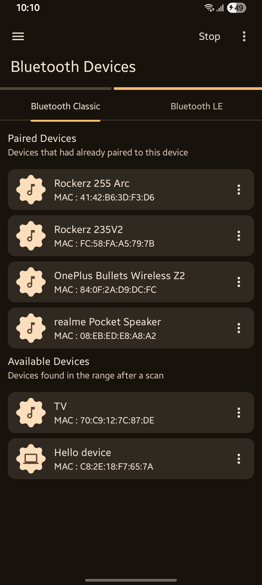
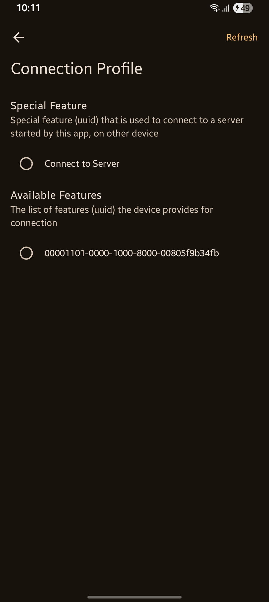
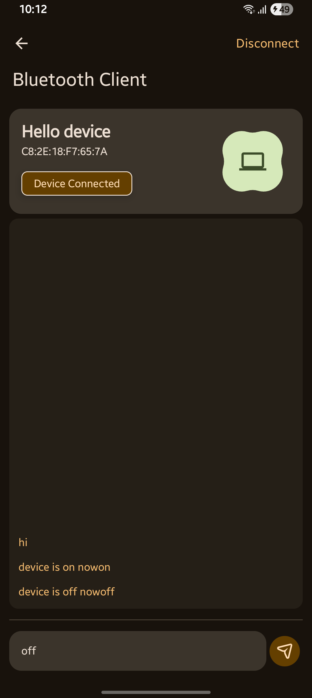
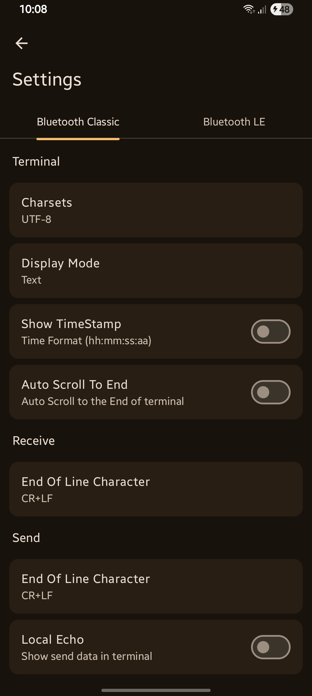
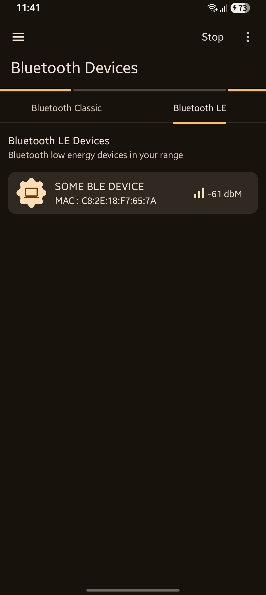
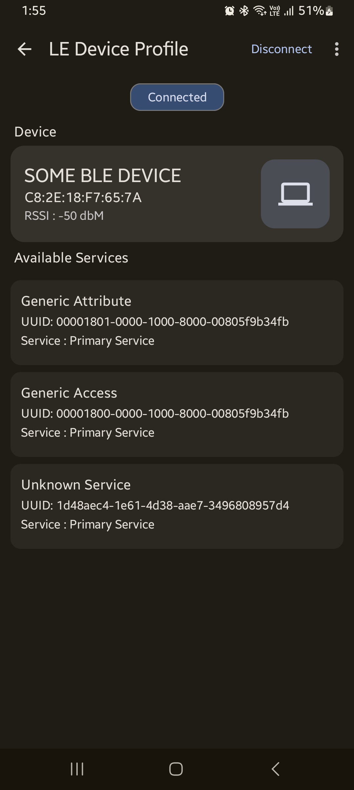
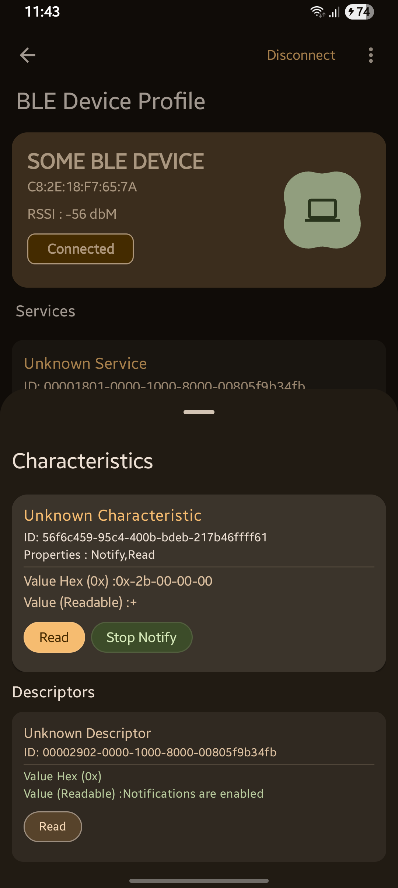
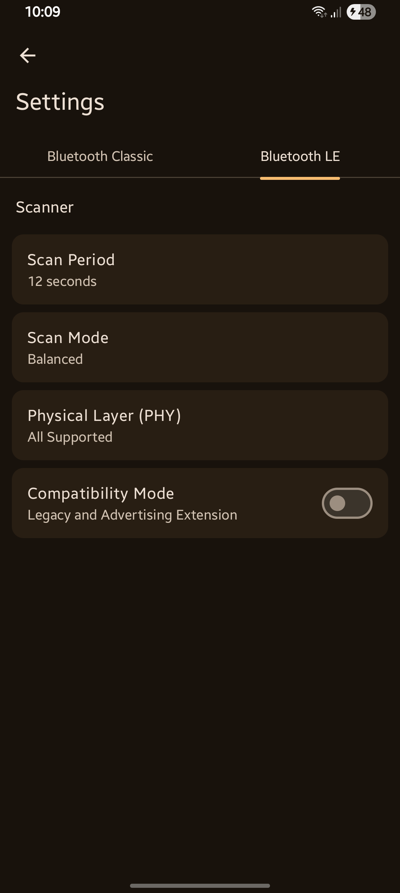

# :large_blue_circle: Bluetooth Terminal App

Bluetooth Terminal App lets you connect to and communicate with Bluetooth Classic and Bluetooth Low
Energy (BLE) devices. It is designed to help explore devices and debug Bluetooth-enabled hardware,
including ESP32-based microcontrollers.

## :information_desk_person: Features

### Bluetooth Classic

- Scan for nearby devices and view paired devices.
- Connect to a device over Serial Port Profile (SPP) and exchange data.
- Run an SPP server so another device can connect to the app.
- Configure client and server connection settings, including a custom SPP service UUID.
- Use SPP connection automation and send raw bytes.

### Bluetooth Low Energy (BLE)

- Scan for nearby BLE devices and inspect their services and characteristics.
- Read, write, and subscribe to characteristic updates when supported by the device.
- Run a BLE server with services including battery and light-sensor data.
- Configure BLE scan settings.

## :camera_flash: Screenshots

Classic Bluetooth connection screens:

<p align="center">
   
   
   
   
</p>

Bluetooth Low Energy screens:

<p align="center">
   
   
   
   
</p>

## :building_construction: Getting Started

The app requires a device with Bluetooth. BLE features require BLE-capable hardware; BLE support is
optional on devices that install the app. The minimum supported Android version is Android 9 (API
28). Grant the Bluetooth permissions requested by Android when using the corresponding features.

1. **Clone the repository:**

   ```bash
   git clone https://github.com/tuuhin/BTAndroidApp.git
   ```

2. **Open the project:**
   Open the cloned project in Android Studio.

3. **Build and run:**
   Build the app and run it on a compatible Android device or emulator with Bluetooth support.

### :curly_loop: Feedback and Support

If you encounter a problem or find a bug,
please [open an issue](https://github.com/tuuhin/BTAndroidApp/issues/new).

### :man_cook: Contributing

Contributions are welcome! Please review the [Contribution Guidelines](CONTRIBUTING.md) before
submitting a pull request or issue.

## :end: Conclusion

Bluetooth Terminal App is a tool for interacting with Bluetooth Classic and BLE devices,
particularly useful when debugging Bluetooth-enabled microcontrollers. If you have feedback or
encounter a problem, please [open an issue](https://github.com/tuuhin/BTAndroidApp/issues/new).

### :revolving_hearts: Special Thanks

Special thanks to the teams behind these open-source Bluetooth apps:

- [Nordic Semiconductor Android app](https://github.com/NordicSemiconductor/Android-nRF-Connect)
- [Simple Bluetooth Terminal](https://github.com/kai-morich/SimpleBluetoothTerminal)